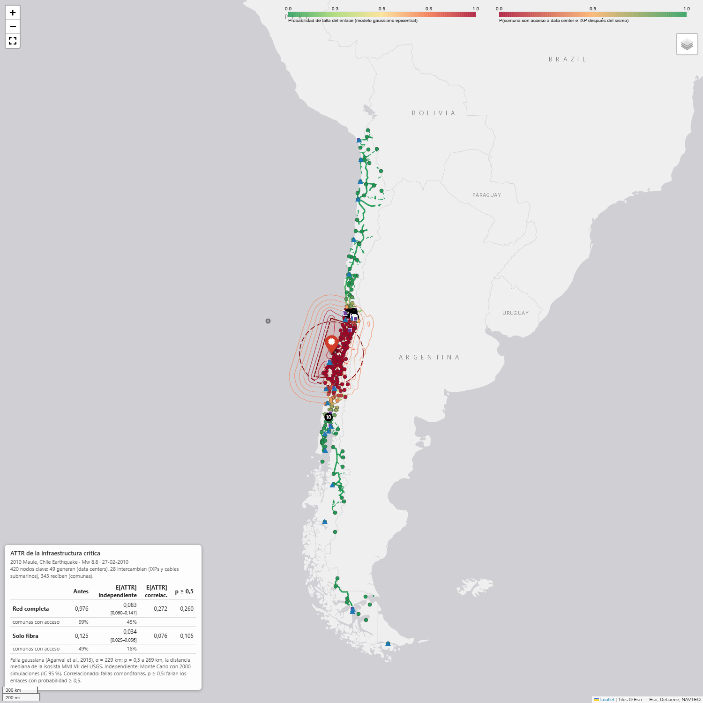

# Resiliencia de la Internet chilena frente al terremoto Mw 8.8 (Maule, 2010)

Tarea individual 2 de Ruteo. Toma la infraestructura física de Internet levantada por el
proyecto Yafún (NIC Labs, 2018), la convierte en una topología con pgRouting, identifica los
nodos clave y calcula el **ATTR** (*Average Two-Terminal Reliability*) antes y después del
terremoto 8.8, usando un modelo de falla probabilístico tomado de la literatura.



## Resultado

| Red | ATTR antes | E[ATTR] después (fallas independientes) | Escenario p ≥ 0,5 | E[ATTR] después (fallas correlacionadas) |
|---|---|---|---|---|
| Completa (fibra + postación + caminos + ferry) | **0,976** | **0,083** (IC 95 % 0,060 – 0,141) | 0,260 | 0,272 |
| Solo fibra detectada | **0,125** | **0,034** (IC 95 % 0,025 – 0,056) | 0,105 | 0,076 |

- 420 nodos clave: 49 **generan** (data centers), 28 **intercambian** (9 IXPs y 19 aterrizajes
  de cables submarinos) y 343 **reciben** (comunas).
- Comunas con acceso a un data center y a un IXP: 98,5 % antes, 45,3 % después (red completa).
- El enlace más crítico es un tramo de fibra de 11 km a la salida norte de Santiago (Ruta 5).
  Es un puente: si falla, se separan del resto los 97 nodos clave desde Arica hasta la Región
  de Valparaíso.

## Cómo ejecutarlo

Requisitos: Docker y Python 3.10 o superior.
(Windows)
```bash
docker compose up -d                       # PostgreSQL 17 + PostGIS 3.5 + pgRouting 3.8 (puerto 5434)
python -m venv .venv
.venv\Scripts\activate                    
pip install -r requirements.txt
python main.py --abrir                    
```
(Mac/Linux)
```bash
docker compose up -d                       
python -m venv .venv
source .venv/bin/activate
pip install -r requirements.txt
python main.py --abrir                     
```

`main.py` también corre por pasos:

| Comando | Qué hace |
|---|---|
| `python main.py cargar` | Carga en la BD los shapefiles de Yafún, los nodos clave y el sismo en GeoJSON (`sql/01_esquema.sql`) |
| `python main.py topologia` | Nodado y `pgr_createTopology` (`sql/02_topologia.sql`) |
| `python main.py grafo` | Accesos de los nodos clave, malla del Gran Santiago, enlaces y función `attr_red` (`sql/03_grafo.sql`) |
| `python main.py falla` | Probabilidad de falla por enlace (`sql/04_falla.sql`) y genera **`main.sql`** |
| `python main.py attr` | ATTR antes y después (Monte Carlo y escenarios), enlaces críticos → `salida/resultados.json` |
| `python main.py mapa --abrir` | Mapa Leaflet → `salida/mapa.html` |

Opciones: `--simulaciones N` (2000 por defecto) y `--sigma KM` (0 = calibrar con el ShakeMap).
La conexión se configura con `PGHOST`, `PGPORT`, `PGDATABASE`, `PGUSER` y `PGPASSWORD`
(por defecto `localhost:5434`, usuario `ruteo`, clave `ruteo`).

El ATTR también se puede consultar directo en SQL:

```sql
SELECT * FROM attr_red('completa');                 -- antes del sismo
SELECT * FROM attr_red('fibra', 0.5, 'p_falla');    -- después: fallan los enlaces con p >= 0,5
```

## Modelo en breve

- **Topología**: nodado con `ST_UnaryUnion`, porque `pgr_nodeNetwork` falla con estos datos,
  y después `pgr_createTopology` con tolerancia de unos 11 m. Las cadenas de grado 2 se
  agrupan en **enlaces** (unión entre dos nodos de la red).
- **Nodos clave**: data centers e IXPs de PeeringDB, aterrizajes de cables de TeleGeography y
  centros comunales de OpenStreetMap. Cada uno se une a la red por los vértices a menos de
  2 km (supuesto S1 del estudio). El Gran Santiago, que Yafún no recorrió, se une con una
  malla urbana supuesta (supuesto S2).
- **Falla**: `p = exp(−d² / 2σ²)`, donde d es la distancia mínima del enlace al epicentro y
  σ = 228,8 km, de modo que p = 0,5 a la distancia mediana de la isosista MMI VII del USGS.
  Se incluyen las variantes lineal y por distancia a la ruptura.
- **ATTR después**: valor esperado con fallas independientes (Monte Carlo, cota pesimista) y
  con fallas totalmente correlacionadas (radio de daño, cota optimista), más el escenario
  determinista p ≥ 0,5.

## Estructura

```
main.py                  orquestador (CLI)
main.sql                 probabilidades de falla por enlace (generado)
docker-compose.yml       PostGIS + pgRouting 3.8
sql/                     01 esquema · 02 topología · 03 grafo + attr_red() · 04 modelo de falla
tarea/                   carga, enlaces, attr (Monte Carlo), mapa (folium/Leaflet), exportar
scripts/                 descargar_datos.py · capturas_mapa.py · graficos.py
data/                    infraestructura (shp) · nodos (geojson) · sismo (USGS) · contexto
salida/                  mapa.html · resultados.json
```

## Fuentes

- Infraestructura: proyecto Yafún, NIC Chile Research Labs (2018), entregada por Subtel.
- Estudio: *Estudio y Recomendaciones sobre la resiliencia de la infraestructura de la Internet
  chilena*, NIC Labs / CORFO / Subtel (2018).
- Sismo: USGS ComCat, evento `official20100227063411530_30`, y ShakeMap.
- Nodos: PeeringDB, TeleGeography Submarine Cable Map y © colaboradores de OpenStreetMap (ODbL).
- ATTR: Boettcher et al. (2018), IEEE Latin America Transactions 16(9).
- Modelo de falla: Agarwal et al. (2013), IEEE/ACM Transactions on Networking 21(5).
